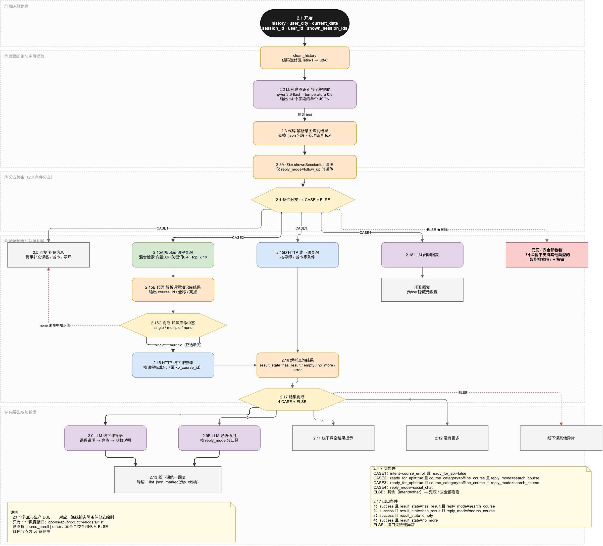
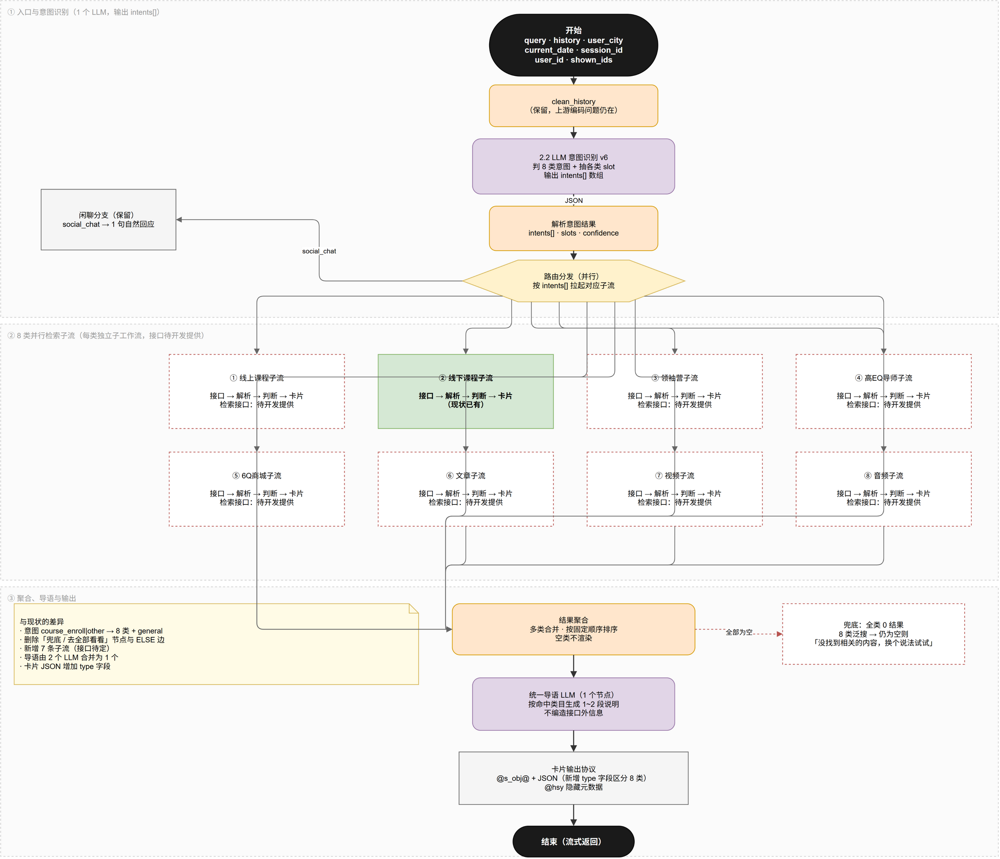
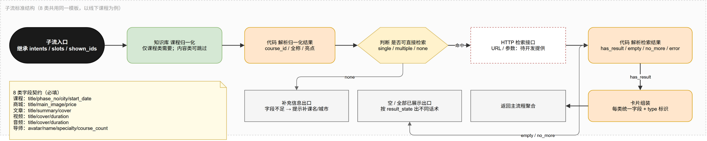

# 6Q 超级搜索 v6 需求说明书（全站智能检索）

| 项 | 内容 |
|----|------|
| 版本 | v6.0 草案 |
| 日期 | 2026-11-02 |
| 范围 | 需求说明 + 原型设计（本版不含 DSL 实现与前端开发） |
| 上游依据 | 生产 DSL `（生产勿动）AI超级搜索（加课程说明）.yml`、v6 全站范围规划 |
| 配套图 | `diagrams/01-现状-Dify流程-过往版本.png`、`02-v6-智能体画布-目标架构.png`、`03-v6-子流标准结构.png` |

---

## 1. 本次要解决的问题

现状的 AI 智搜只支持「线下课程期数」一类数据。用户搜商城、文章、视频、音频时，得到的是固定话术：

> 小Q暂不支持其他类型的智能检索哦
> 你可以去全部看看：[去全部看看]

v6 把这句话**整段删除**，改为：8 类数据全部在 AI 智搜里直接给出结果卡片，按命中类型呈现，不跳转、不提示不支持。

| 维度 | 现状 | v6 |
|------|------|----|
| 可检索数据类型 | 1 类（线下课程期数） | **8 类 + 泛搜兜底** |
| 意图枚举 | `course_enroll` / `other` | 8 类 + `general` |
| 未命中处理 | 「暂不支持」+ 跳转全部 Tab | 泛搜兜底，仍无结果才说「没找到」 |
| 结果承载 | AI 智搜 + 传统类目 Tab 双轨 | 收敛到 AI 智搜对话内 |
| 检索接口 | 1 个（期数） | 8 个（7 个待开发提供） |

---

## 2. 数据类型范围（8 类）

| # | 数据类型 | 意图码 | 检索目标 | 接口状态 |
|---|----------|--------|----------|----------|
| 1 | 线上课程 | `online_course` | 录播课 / 专栏 | ⬜ 待提供 |
| 2 | 线下课程 | `offline_course` | 开班课期数 | ✅ 已有 |
| 3 | 领袖营 | `leader_camp` | 营期活动 | ⬜ 待提供 |
| 4 | 高EQ导师 | `mentor` | 导师个人 | ⬜ 待提供 |
| 5 | 6Q商城 | `mall_goods` | 实物 / 盲盒 | ⬜ 待提供 |
| 6 | 文章 | `article` | 图文内容 | ⬜ 待提供 |
| 7 | 视频 | `video` | 短视频 / 试看 | ⬜ 待提供 |
| 8 | 音频 | `audio` | 音频专辑 / 单集 | ⬜ 待提供 |
| — | 泛搜兜底 | `general` | 8 类并行 | 同上 |

**展示顺序**（命中多类时并列）：

```
线上课程 → 线下课程 → 领袖营 → 高EQ导师 → 6Q商城 → 文章 → 视频 → 音频
```

---

## 3. 现状流程（过往版本）



### 3.1 链路拆解

| 阶段 | 节点 | 作用 |
|------|------|------|
| 输入 | 2.1 开始 | 接收 `history` `user_city` `current_date` `session_id` `user_id` `shown_session_ids` |
| 预处理 | clean_history | 修复上游 latin-1/utf-8 乱码 |
| 识别 | 2.2 LLM 意图识别 | 输出 14 字段单一 JSON，`intent` 只有两值 |
| 解析 | 2.3 代码 | 去 Markdown 包裹、处理嵌套 `text` |
| 清洗 | 2.3A 代码 | 仅 `follow_up` 时透传 `shownSessionIds` |
| 路由 | 2.4 条件分支 | 4 CASE + ELSE |
| 检索 | 2.15A 知识库 → 2.15B 解析 → 2.15C 判断 | 课名归一化，输出 `single`/`multiple`/`none` |
| 检索 | 2.15 / 2.15D HTTP | 同一个期数接口，差别在传不传 `courseId` |
| 解析 | 2.16 代码 | `result_state`：`has_result`/`empty`/`no_more`/`error` |
| 判断 | 2.17 条件分支 | 4 CASE + ELSE |
| 生成 | 2.9 / 2.9B LLM | 导语文案，两套口径 |
| 输出 | 2.13 / 2.11 / 2.12 / 闲聊 / 异常 | 文本 + `@s_obj@` 卡片 + `@hsy` 元数据 |

### 3.2 现状的结构性问题

1. **只有 1 条数据链路**：23 个节点全部服务线下课程，其余 7 类没有落点。
2. **节点会失控**：按同样密度堆 8 类，节点数将超过 150 个。
3. **导语由 2 个 LLM 节点分别生成**，再在 2.13 靠分支互斥隐式合并，改流程时容易双值同时出现。
4. **意图识别 temperature = 0.8**，分类任务偏高，输出会抖动。
5. **知识库边界是正确的**：只放课名 / 课程 ID / 亮点文案，期数、价格、名额走 HTTP。这一点 v6 保留。

---

## 4. 目标画布架构



### 4.1 一句话结构

```
入口 → 意图识别（1 个 LLM）→ 路由（并行）→ 8 个子流 → 聚合 → 统一导语（1 个 LLM）→ 卡片输出
```

### 4.2 与现状的节点对应

| v6 节点 | 类型 | 对应现状 | 处理方式 |
|---------|------|----------|----------|
| V1 开始 | start | 2.1 | 复用，新增 `intents` 相关入参说明 |
| V2 clean_history | code | clean_history | 原样保留 |
| V3 意图识别 v6 | llm | 2.2 | **重写 Prompt**（见 §5） |
| V4 解析意图结果 | code | 2.3 | 改为解析 `intents[]`，其余逻辑复用 |
| V5 路由分发 | if-else | 2.4 | 4 CASE → 8 CASE + 2（闲聊 / 兜底） |
| V6.1~V6.8 子流 | 子工作流 | 2.15A~2.17 | 线下课程复用，其余 7 条新建 |
| V7 结果聚合 | code | 2.13 部分 | **新增**，多类合并 + 排序 |
| V8 统一导语 | llm | 2.9 + 2.9B | **合并为 1 个**，按类目分口径 |
| V9 卡片输出 | answer | 2.13 | 协议扩展 `type` 字段 |
| V10 兜底 | answer | 兜底/去全部看看 | **重写话术**，去掉跳转 |
| V11 闲聊 | llm + answer | 2.18 + 闲聊回复 | 原样保留 |

### 4.3 子流标准结构



8 类子流内部结构一致：

```
子流入口 → 知识库归一化（课程类才需要）→ 解析 → 判断是否可检索
  → HTTP 检索接口（待开发提供）→ 解析结果 → 卡片组装 → 返回聚合
  ↘ 字段不足 → 补充信息出口
  ↘ 无结果 / 已全部展示 → 空态出口
```

**设计理由**：子流隔离后，新增/下线一类数据只动一个子流，不影响其他 7 类；节点总数可控（主流程 11 个 + 每子流 5~7 个）。

---

## 5. 节点 V3：意图识别 Prompt（完整可复制）

> 模型建议：`qwen3.6-flash`，**temperature 0.1**（现状 0.8 过高，分类任务会抖）。
> 输出必须是单个 JSON 对象，不带任何解释。

### 5.1 System Prompt

```text
你是 6Q APP 的 AI 超级搜索助手。

只做两件事：
1. 判断用户当前问题命中哪几类数据（可多选）
2. 提取各类检索所需的字段

不回答业务内容，不生成实时数据，不编造任何接口外的信息。

【运行时变量】
- query：用户当前问题
- history：前文查询摘要
- shown_ids：已展示结果 ID 摘要
- user_city：用户定位城市，可为空
- current_date：当前日期

【数据类别（data_category）】
只允许以下 9 个值：
- online_course   线上课程：网课、录播、专栏、线上学习
- offline_course  线下课程：开班、开课、期数、报名、城市+课程
- leader_camp     领袖营：营、夏令营、冬令营、集训营、亲子营
- mentor          高EQ导师：导师、老师、谁讲、擅长什么
- mall_goods      6Q商城：买、盲盒、公仔、潮玩、周边、价格
- article         文章：文章、干货、原理、案例、怎么理解
- video           视频：视频、讲解、短视频、试看、看一段
- audio           音频：音频、听、录音、电台、专辑
- general         无法归类，或明显跨多类

【多类别规则】
- 一句话可以命中多个类别，输出数组，按下列固定顺序排列：
  online_course, offline_course, leader_camp, mentor, mall_goods, article, video, audio
- 只有语义明确指向该类时才命中，不要为了「可能相关」而多选。
- 例：「恋爱咨询」→ ["article", "video", "audio"]
- 例：「智慧父母一阶」→ ["offline_course"]
- 例：「有没有讲情绪管理的课」→ ["online_course", "offline_course"]
- 例：「6Q潮玩盲盒」→ ["mall_goods"]
- 例：「你好」→ ["general"]，且 social_chat = true

【类目判定要点】
- 出现「期」「第几期」「开课」「报名」「名额」→ 必含 offline_course
- 出现「营」「夏令营」→ 必含 leader_camp；若同时含「课程/期/报名」，可同时含 offline_course
- 出现「谁讲」「老师」「导师」且句意在找人 → 必含 mentor；
  若句意是「找这位老师讲的课」，则 mentor 与 offline_course 同时命中
- 出现「买」「多少钱」「盲盒」「公仔」→ 必含 mall_goods
- 出现「文章/干货/原理」→ article；「视频/讲解」→ video；「音频/听」→ audio
- 泛词（如「6Q」「学习」「亲子」）无法判断时 → ["general"]

【字段提取】
common：
- keyword：当前 query 原文，不改写、不截断

offline_course：
- course_name、city、instructor_name、phase_no、date_from、date_to
online_course：
- course_name、topic
leader_camp：
- camp_name、city、season
mentor：
- mentor_name、specialty
mall_goods：
- goods_name、goods_type（实物/盲盒）、price_range
article / video / audio：
- topic、author（仅文章）、duration_range（仅视频/音频）

【课程名固定映射（沿用现状，不得自行新增）】
- 「一阶」「一阶课程」→ 《高EQ智慧父母》一阶
- 「二阶」「二阶课程」→ 《高EQ智慧父母》(二阶)
- 「高SQ」→ 《高SQ智慧父母》，「高AQ」→ 《高AQ智慧父母》
- 「高IQ」→ 《高IQ智慧父母》，「高CQ」→ 《高CQ智慧父母》
- 「高RQ」→ 《高RQ智慧父母》基础班；「高RQ 进阶」→ 进阶班
- 「沙龙」→ 6Q读书沙龙；「创意沙龙」→ 6Q创意沙龙（定制版）
- 「恩爱夫妻」「恩爱夫妻工作坊」→ 高EQ亲密关系工作坊
- 「亲子沟通心灵密码」「分享会」→ 《亲子沟通心灵密码》分享会
强约束：只允许使用以上映射，不得延伸或猜测；明确全称优先于泛称；
「专业课」单独出现时不得擅自判断为一阶或二阶。

【城市与附近规则】
1. query 明确出现城市名 → city = 该城市，location_mode = city，不继承 history
2. query 含「附近 / 本地 / 离我近一点」→ location_mode = nearby；
   user_city 非空则 city = user_city，否则 city 为空
3. query 未提城市且非附近 → 忽略 user_city；history 有明确 city 才继承，否则空
4. 严禁根据 user_city、常识或默认城市猜测 city

【时间规则】
- date_from / date_to 格式 YYYY-MM-DD
- 近期 → 未来 30 天；这几天 → 未来 7 天；这周 → 本周一至周日
- 这个月 → 本月 1 日至月末；今年 → current_date 至 12-31
- 未给时间且是课程检索 → 默认未来 30 天

【续聊规则】
- 明确给出的条件优先于 history
- 除非用户明说「重新开始 / 换个话题」，否则结合 history 补全
- history 只能补缺，不能编造，不能覆盖当前 query 的明确条件
- 冲突时以当前 query 为准

【是否可检索（ready）】
按命中的每个类别分别判断，只要有一个类别可检索即 ready = true：
- 课程类：course_name 或 city 或 instructor_name 或 phase_no 任一非空
- 内容类（文章/视频/音频）：keyword 非空即视为可检索
- 商城：keyword 非空即视为可检索
- 导师：mentor_name 或 specialty 任一非空，否则用 keyword 兜底
- 领袖营：keyword 非空即视为可检索
- 特例：location_mode = nearby 且 user_city 为空时，
  city 置空、ready = false、missing 必含 city

【social_chat】
纯问候、道谢、告别、闲聊（「你好」「在吗」「谢谢」「再见」「你是谁」）→ true
其余一律 false

【输出 JSON 结构】
只输出如下结构，字段必须全部存在，无值用空字符串或空数组，不要输出 null：

{
  "intents": ["offline_course"],
  "keyword": "用户原话",
  "social_chat": false,
  "ready": true,
  "confidence": 0.0,
  "slots": {
    "offline_course": {
      "course_name": "", "city": "", "instructor_name": "",
      "phase_no": "", "date_from": "", "date_to": "", "location_mode": "none"
    },
    "online_course":  { "course_name": "", "topic": "" },
    "leader_camp":    { "camp_name": "", "city": "", "season": "" },
    "mentor":         { "mentor_name": "", "specialty": "" },
    "mall_goods":     { "goods_name": "", "goods_type": "", "price_range": "" },
    "article":        { "topic": "", "author": "" },
    "video":          { "topic": "", "duration_range": "" },
    "audio":          { "topic": "", "album": "" }
  },
  "missing": [],
  "is_follow_up": false
}
```

### 5.2 User Prompt（变量注入）

```text
query: {{#sys.query#}}
history: {{#clean_history.clean_history#}}
shown_ids: {{#start.shown_ids#}}
user_city: {{#start.user_city#}}
current_date: {{#start.current_date#}}
session_id: {{#start.session_id#}}
user_id: {{#start.user_id#}}
```

### 5.3 强制自测（写进 Prompt 末尾，防止漂移）

| 输入 | 期望 |
|------|------|
| `一阶课程`（user_city=广州，history 无 city） | `intents=["offline_course"]`，`course_name=《高EQ智慧父母》一阶`，`city=""` |
| `我附近的一阶课程`（user_city=广州） | `city=广州`，`location_mode=nearby` |
| `恋爱咨询` | `intents=["article","video","audio"]` |
| `6Q潮玩盲盒` | `intents=["mall_goods"]`，`ready=true` |
| `有哪些老师擅长情绪管理` | `intents=["mentor"]`，`specialty=情绪管理` |
| `聪明父母二阶的刘中良导师广州站` | `intents=["offline_course"]`，四字段齐全 |
| `你好` | `intents=["general"]`，`social_chat=true` |

---

## 6. 节点 V5：路由分发规则

条件节点，按 `intents[]` 分流。建议实现方式：Dify 条件分支的 CASE 用「包含」比较，逐个类目判断。

| CASE | 条件 | 去向 |
|------|------|------|
| C0 | `social_chat = true` | 闲聊子流 |
| C1 | `intents` 包含 `online_course` | 线上课程子流 |
| C2 | `intents` 包含 `offline_course` | 线下课程子流 |
| C3 | `intents` 包含 `leader_camp` | 领袖营子流 |
| C4 | `intents` 包含 `mentor` | 导师子流 |
| C5 | `intents` 包含 `mall_goods` | 商城子流 |
| C6 | `intents` 包含 `article` | 文章子流 |
| C7 | `intents` 包含 `video` | 视频子流 |
| C8 | `intents` 包含 `audio` | 音频子流 |
| ELSE | 以上都不命中，或 `ready = false` | 兜底子流 |

**并行说明**：多类命中时，C1~C8 可同时成立。Dify 的 if-else 是单出口，因此实际实现为「多个条件节点串联，每条分支各自拉起子流，最后在聚合节点汇合」，或用迭代节点遍历 `intents[]`。

> 若 Dify 版本支持并行分支，优先用并行；否则用「路由节点 + 子流 + 汇合」的串行扇出结构，功能等价，只是耗时叠加。

---

## 7. 8 类子流设计

每类子流结构相同（见 §4.3）。下表只列**差异部分**：接口、字段、卡片、空态话术。

### 7.1 线上课程

| 项 | 内容 |
|----|------|
| 检索接口 | `【待开发提供】` |
| 入参 | `keyword` `courseName` `topic` `userId` `sessionId` |
| 出参字段 | `id` `title` `cover` `type`（专栏/课程）`price` `learnedCount` `teacher` |
| 卡片样式 | 封面 + 左上角「专栏」角标 + 标题 + 免费/价格 + N 人已学习 |
| 空态 | 暂时没有找到和「{keyword}」相关的线上课程，换个关键词试试 |

### 7.2 线下课程（现状复用）

| 项 | 内容 |
|----|------|
| 检索接口 | `GET https://www.6qedu.cn/goods/api/product/periods/ai/list`（现状） |
| 前置 | 知识库课程归一化（`single`/`multiple` 才直查，`none` 走通用查询） |
| 入参 | `userId` `sessionId` `keyword` `courseId` `courseName` `city` `instructorName` `phaseNo` `dateFrom` `dateTo` `shownSessionIds` |
| 出参字段 | 沿用现状 `list_json` |
| 空态 | 暂时没有找到 {course_name} 匹配的课程期数，请换课程、导师、地址、时间试试看 |
| 无更多 | {course_name} 没有更多的课程期数了！看看其他课程吧！ |

### 7.3 领袖营

| 项 | 内容 |
|----|------|
| 检索接口 | `【待开发提供】` |
| 入参 | `keyword` `campName` `city` `season` `userId` |
| 出参字段 | `id` `title` `cover` `campType` `city` `startDate` `endDate` `ageRange` `price` `seatsLeft` |
| 卡片样式 | 封面 + 营期角标 + 标题 + 城市/日期 + 适龄 + 名额 |
| 空态 | 暂时没有找到和「{keyword}」相关的营期 |

### 7.4 高EQ导师

| 项 | 内容 |
|----|------|
| 检索接口 | `【待开发提供】` |
| 入参 | `keyword` `mentorName` `specialty` `userId` |
| 出参字段 | `id` `avatar` `name` `title` `specialty` `courseCount` `intro` |
| 卡片样式 | 头像 + 姓名 + 职称 + 擅长领域标签 + 在授课程数 |
| 空态 | 暂时没有找到匹配的导师 |
| 备注 | **现状无此实体**，导师只是期数接口的筛选参数。本类需后端新增导师实体与接口 |

### 7.5 6Q商城

| 项 | 内容 |
|----|------|
| 检索接口 | `【待开发提供】` |
| 入参 | `keyword` `goodsName` `goodsType` `priceRange` `userId` |
| 出参字段 | `id` `title` `mainImage` `price` `originPrice` `sales` `goodsType` |
| 卡片样式 | 商品图 + 标题 + 现价 + 划线原价 |
| 空态 | 暂时没有找到和「{keyword}」相关的商品 |

### 7.6 文章

| 项 | 内容 |
|----|------|
| 检索接口 | `【待开发提供】` |
| 入参 | `keyword` `topic` `author` `page` `size` |
| 出参字段 | `id` `title` `cover` `summary` `author` `publishTime` `readCount` |
| 卡片样式 | 「文章」角标 + 封面 + 标题 + 两行摘要 |
| 空态 | 暂时没有找到和「{keyword}」相关的文章 |

### 7.7 视频

| 项 | 内容 |
|----|------|
| 检索接口 | `【待开发提供】` |
| 入参 | `keyword` `topic` `durationRange` `page` `size` |
| 出参字段 | `id` `title` `cover` `duration` `playCount` `isTrial` |
| 卡片样式 | 标题 + 「试看」角标 + 封面 + 播放量 + 时长 |
| 空态 | 暂时没有找到和「{keyword}」相关的视频 |

### 7.8 音频

| 项 | 内容 |
|----|------|
| 检索接口 | `【待开发提供】` |
| 入参 | `keyword` `topic` `album` `page` `size` |
| 出参字段 | `id` `title` `cover` `duration` `playCount` `album` |
| 卡片样式 | 封面 + 标题 + N 万人听过 |
| 空态 | 暂时没有找到和「{keyword}」相关的音频 |

### 7.9 数据源选型说明

已定：**内容类统一走系统自身接口**，不再用知识库兜底。详见技术方案页 §6。

| 通道 | 适用类目 | 说明 |
|------|----------|------|
| HTTP 接口 | 全部 8 类 | 线下课程沿用现网期数接口；线上课 / 领袖营 / 商城 / 导师 / 文章 / 视频 / 音频各自调系统接口 |
| 知识库 | 仅课程名归一化（2.15A） | 不承载内容数据 |

**判定红线**：期数、名额、价格、库存只能来自 HTTP，模型不得生成或推算。缺失时字段留空、不展示。

接口出参至少包含 `id` 与 `title`，否则卡片无法组装。字段名不统一时在 DSL 的 3.8 代码节点里做别名映射，不要求后端改字段。回填位置见 `dsl/README.md` 第二节。

---

## 8. 节点 V8：统一导语 Prompt

> 合并现状的 2.9 与 2.9B，一个节点覆盖 8 类。temperature 建议 0.5。

### 8.1 System Prompt

```text
你是 6Q APP AI 超级搜索的结果说明助手。

根据已经查询到的各类结果，生成 1~2 段给用户看的说明文字。

【硬性要求】
1. 只输出给用户看的文字，不输出 JSON、不输出字段名
2. 不编造接口里没有的信息
3. 不主动提价格、名额、库存、报名状态，除非结果里明确有且用户问到了
4. 不罗列技术字段
5. 结尾不要出现「去全部看看」这类跳转引导
6. 按实际命中的类别组织语句，未命中的类别不要提及

【组织顺序】
若命中多类，按此顺序提一句即可，不要逐个列清单：
线上课程 → 线下课程 → 领袖营 → 高EQ导师 → 6Q商城 → 文章 → 视频 → 音频

【句首条件组织】
已识别的条件按「时间范围 → 导师 → 城市 → 名称/关键词」自然串联，
不要机械罗列，不要出现「城市=」这类写法。

【分类口径】
- 只命中线下课程：「为您查询{date}范围内{导师}在{city}的{课程名}课程，以下是符合要求的信息和报读期数：」
- 只命中线上课程：「已为你整理和「{keyword}」相关的线上课程：」
- 只命中导师：「为你找到以下擅长{specialty}的导师：」
- 只命中商城：「为你找到以下和「{keyword}」相关的商品：」
- 只命中文章：「为你整理了几篇和「{keyword}」相关的文章：」
- 只命中视频：「为你找到以下和「{keyword}」相关的视频：」
- 只命中音频：「为你找到以下和「{keyword}」相关的音频：」
- 只命中领袖营：「为你找到以下和「{keyword}」相关的营期：」
- 多类命中：「关于「{keyword}」，我找到了{sections}这几类内容：」
  （sections 用「、」连接实际命中的类别名，如「相关文章、视频和音频」）

【续聊口径】
is_follow_up = true 时，用「已继续为你补充筛选更多结果，以下是补充内容：」开头。

【字数】
1~2 句为主，最多 60 字。不要写小作文。
```

### 8.2 User Prompt

```text
keyword: {{#parse.keyword#}}
intents: {{#parse.intents#}}
is_follow_up: {{#parse.is_follow_up#}}
city: {{#parse.slots.offline_course.city#}}
instructor_name: {{#parse.slots.offline_course.instructor_name#}}
course_name: {{#parse.slots.offline_course.course_name#}}
date_from: {{#parse.slots.offline_course.date_from#}}
date_to: {{#parse.slots.offline_course.date_to#}}
section_counts: {{#aggregate.section_counts#}}
```

---

## 9. 节点 V7 / V9：聚合与卡片协议

### 9.1 聚合输出

```json
{
  "sections": [
    { "type": "offline_course", "total": 4, "items": [ … ] },
    { "type": "article",        "total": 3, "items": [ … ] },
    { "type": "video",          "total": 1, "items": [ … ] }
  ],
  "section_counts": "线下课程 4、文章 3、视频 1",
  "all_empty": false
}
```

- 空类**不进** `sections`（不渲染空壳）
- 顺序固定为 §2 的 8 类顺序
- 单类最多 5 条；多类并列时每类最多 3 条

### 9.2 卡片协议（相对现状的唯一改动）

现状 `@s_obj@` 里是纯数组，APP 只能当一种卡片渲染。v6 必须带 `type`：

```
@s_obj@{"type":"article","total":3,"items":[…]}
…（多类时按顺序拼多个块）
@e_obj@
```

| 标记 | 用途 | 是否变化 |
|------|------|----------|
| `@s_obj@ … @e_obj@` | 卡片数据 | 内容加 `type` 字段 |
| `@hsy … @_hsy` | 隐藏元数据 | 不变 |
| `@s_obj@按钮:去全部看看@e_obj@` | 跳转按钮 | **删除** |

---

## 10. 节点 V10 / V11：兜底与闲聊

### 10.1 兜底（替换现状「去全部看看」）

触发条件：`intents` 为 `["general"]`，或所有命中子流全类 0 条。

| 场景 | 话术 |
|------|------|
| 泛搜后有结果 | 按实际命中类目，走 §8 多类口径 |
| 泛搜后仍 0 条 | `没找到相关的内容，换个说法试试` |
| 接口异常 | `当前检索服务有点异常，请稍后再试试哦` |

**注意**：不再出现「暂不支持该类型」的表述。这类话术在 v6 中全部废弃。

### 10.2 闲聊（沿用现状 2.18）

条件：`social_chat = true`。输出 1 句自然回应，不引导搜索、不罗列课程信息。

---

## 11. 需求清单

| # | 一级模块 | 二级模块 | 功能描述 | 需求类型 | 团队 | 实现方案 |
|---|----------|----------|----------|----------|------|----------|
| 1 | AI智搜 | 意图识别 | 意图枚举扩到 8 类 + general，输出 `intents[]` 数组，支持一次命中多类 | 改造 | 产品+研发 | Dify 节点 V3 重写 Prompt |
| 2 | AI智搜 | 意图识别 | temperature 由 0.8 降至 0.1，提升分类稳定性 | 改造 | 研发 | 模型参数 |
| 3 | AI智搜 | 意图识别 | 解析节点支持 `intents[]` 与分类 slots 结构 | 改造 | 研发 | Dify 节点 V4 |
| 4 | AI智搜 | 路由 | 4 CASE 扩为 8 CASE + 闲聊 + 兜底 | 改造 | 研发 | Dify 节点 V5 |
| 5 | AI智搜 | 路由 | 多类命中时并行拉起多个子流 | 新需求 | 研发 | 并行分支 / 迭代节点 |
| 6 | AI智搜 | 子流 | 线上课程检索子流 | 新需求 | 研发 | 接口待提供 |
| 7 | AI智搜 | 子流 | 线下课程子流（现状复用，改为子工作流） | 改造 | 研发 | 现有 2.15A~2.17 迁入 |
| 8 | AI智搜 | 子流 | 领袖营检索子流 | 新需求 | 研发 | 接口待提供 |
| 9 | AI智搜 | 子流 | 高EQ导师检索子流（新建导师实体） | 新需求 | 研发+后端 | 接口待提供 |
| 10 | AI智搜 | 子流 | 6Q商城检索子流 | 新需求 | 研发 | 接口待提供 |
| 11 | AI智搜 | 子流 | 文章检索子流 | 新需求 | 研发 | 接口待提供 |
| 12 | AI智搜 | 子流 | 视频检索子流 | 新需求 | 研发 | 接口待提供 |
| 13 | AI智搜 | 子流 | 音频检索子流 | 新需求 | 研发 | 接口待提供 |
| 14 | AI智搜 | 聚合 | 多类结果合并、固定顺序排序、空类不渲染 | 新需求 | 研发 | 节点 V7 |
| 15 | AI智搜 | 导语 | 2 个导语 LLM 合并为 1 个，覆盖 8 类口径 | 改造 | 研发 | 节点 V8 |
| 16 | AI智搜 | 输出 | 卡片协议增加 `type` 字段，APP 按类渲染 | 改造 | 研发+前端 | 节点 V9 |
| 17 | AI智搜 | 降级 | **删除**「暂不支持」话术与「去全部看看」按钮 | 改造 | 研发+前端 | 删除兜底节点与 ELSE 边 |
| 18 | AI智搜 | 降级 | 新增泛搜兜底与「没找到相关内容」话术 | 新需求 | 研发 | 节点 V10 |
| 19 | AI智搜 | 前端 | 8 类结果卡片组件 | 新需求 | 前端 | 原型见 §12 |
| 20 | AI智搜 | 前端 | 分区渲染、类目标题、条数、加载态、空态 | 新需求 | 前端 | 原型见 §12 |
| 21 | AI智搜 | 稳定性 | `2.15` 请求体 `"courseName":,` 空值语法错误修正 | 缺陷 | 研发 | 改为 `""` |
| 22 | AI智搜 | 稳定性 | 导语双 LLM 输出合并导致的隐式依赖消除 | 改造 | 研发 | 合并为节点 V8 |

---

## 12. 原型设计

原型文件：`ai-search-v6.html`（独立页面，与 v5 原型并存，便于对比）

### 12.1 页面结构

```
┌─────────────────────────────┐
│ 搜索框（AI智搜 开关）        │
├─────────────────────────────┤
│ 对话流                       │
│  用户气泡                    │
│  AI 回复                     │
│    导语（1~2 句）            │
│    ┌ 分区 1：标题 + N 条 ┐   │
│    │ 卡片 × 1~3          │   │
│    └─────────────────────┘   │
│    ┌ 分区 2 …             ┐   │
│    └─────────────────────┘   │
├─────────────────────────────┤
│ 底部续聊输入框               │
└─────────────────────────────┘
```

### 12.2 交互要点

| # | 交互 | 说明 |
|---|------|------|
| 1 | 提交搜索 | 意图命中几类就渲染几个分区，未命中不渲染 |
| 2 | 多类并列 | 按固定顺序，每区独立标题 + 条数 |
| 3 | 多类并列时条数 | 每类最多 3 条 + 「N 条」 |
| 4 | 单类命中时条数 | 最多 5 条 |
| 5 | 续聊 | 新结果追加，不清空上文；同一 searchQuery 视为续聊 |
| 6 | 泛搜兜底 | 意图不明 → 8 类都试，仍空则只出一句「没找到相关的内容，换个说法试试」 |
| 7 | 不出现的内容 | **没有任何「去全部看看」按钮、没有任何「暂不支持」话术** |
| 8 | 卡片点击 | 预留点击态，跳转目标由开发定 |

### 12.3 演示用例

| 输入 | 预期分区 |
|------|----------|
| `智慧父母一阶` | 线下课程（期数卡） |
| `有没有讲情绪管理的课` | 线上课程 + 线下课程 |
| `恋爱咨询` | 文章 + 视频 + 音频 |
| `6Q潮玩盲盒` | 6Q商城 |
| `有哪些老师擅长情绪管理` | 高EQ导师 |
| `夏令营` | 领袖营 |
| `随便说说` | 泛搜兜底 / 没找到 |

---

## 13. 验收要点

| # | 用例 | 期望 |
|---|------|------|
| 1 | `智慧父母一阶` | 只出线下课程分区，期数卡与现状一致 |
| 2 | `恋爱咨询` | 文章、视频、音频三个分区并列，顺序正确 |
| 3 | `6Q潮玩盲盒` | 出商城分区，**不出现任何「暂不支持」文字** |
| 4 | `有哪些老师擅长情绪管理` | 出导师卡（头像+擅长），不是期数卡 |
| 5 | `夏令营` | 出领袖营分区 |
| 6 | 全部类别 0 条 | 只输出「没找到相关的内容，换个说法试试」 |
| 7 | 任一子流接口超时 | 其他子流正常出结果，缺失的类目静默不渲染 |
| 8 | 多轮续聊「那视频呢」 | 追加视频分区，上文与已有卡片不清空 |
| 9 | 全量回归 | 10 条用例中**任何一条都不出现「去全部看看」** |
| 10 | 卡片协议 | `@s_obj@` 内每个块都带 `type`，APP 能正确分派渲染 |

---

## 14. 待确认（阻塞开发）

| # | 事项 | 影响 | 建议 |
|---|------|------|------|
| 1 | 7 类检索接口是否已存在 | 无接口则整版跑不通，是最大外部依赖 | 开发按技术方案页 §7.2 模板逐类填补 |
| 2 | ~~内容类是否走知识库~~ | 已定：7 类内容全部走系统接口，不再用知识库 | 接口回填前内容分支报错，属预期 |
| 3 | ~~Dify 是否支持 metadata 过滤~~ | 已不涉及，内容类不再用数据集 | — |
| 4 | 导师是否作为实体 | 决定要不要新建导师表与导师接口 | 若只做「筛期数参数」，则第 4 类降级为线下课程的一个筛选项 |
| 5 | Dify 是否支持并行分支 | 决定 8 类检索是并行还是串行叠加 | 串行时首屏耗时约 8× 单接口，需评估 |
| 6 | ~~知识库内容同步机制与频率~~ | 已不涉及，知识库仅保留课程名归一化 | — |
| 7 | 传统类目 Tab 是否保留 | v6 收敛到 AI 智搜后，Tab 的存在意义 | 建议保留一期作过渡，下一版再议 |
| 8 | 每类条数与「更多」形态 | 影响接口分页参数 | 建议单类 5 条、多类 3 条，更多为同页展开 |
